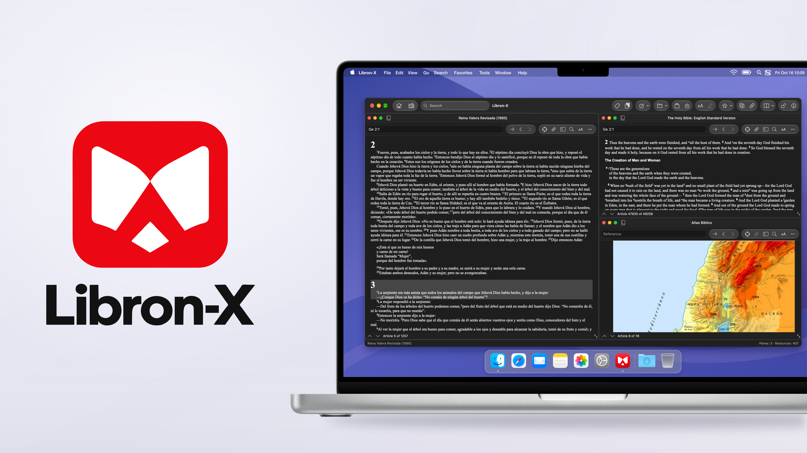

<p align="center">
  
</p>

A native macOS Bible study workspace for local Libronix libraries.

**v0.1 beta · Apple Silicon · macOS 14+**

Read supported books, navigate Bible passages and arrange linked readers in one window. Libron-X is an independent Swift implementation. Compatibility with the original Libronix is incomplete.

## Try the beta

Download **Libron-X-v0.1.zip** from [Releases](https://github.com/EstebanPdNS/Libron-X/releases/tag/v0.1), extract it and move **Libron-X.app** to Applications. The beta is ad-hoc signed and is not notarized; macOS may block it. See [installation](docs/getting-started.md) before opening it.

Books and licenses are not included. Supply your own local resources.

## Available now

- Library browsing, passage navigation and continuous reading for supported resources.
- Multiple reading panes, linked Bibles and parallel Bible groups.
- Basic search, topic browsing, notes, verse lists and favorites.
- Workspace saving, session restoration, copying, printing and selected export formats.
- Native macOS controls and ten interface language choices, including English, Spanish and Portuguese.

These features remain experimental. Advanced searches, add-ins, some resource formats and complete original workflows are still in development. Some messages remain untranslated. See [compatibility](docs/compatibility.md).

## Build

Install Xcode 26 or later (Swift 6.2+ and macOS 26 SDK or later), then run:

```sh
git clone https://github.com/EstebanPdNS/Libron-X.git
cd Libron-X/BibliotecaLibre
scripts/test.sh
scripts/build-rebuild-app.sh
open dist/Libron-X.app
```

The first build downloads pinned Swift package dependencies. [Development guide](docs/development.md).

## Project guide

| Location | Contents |
| --- | --- |
| [BibliotecaLibre/Sources](BibliotecaLibre/Sources) | Current Mac workspace, portable engine, native output and CLI |
| [BibliotecaLibre/Tests](BibliotecaLibre/Tests) | Synthetic regression tests and optional local-corpus checks |
| [docs](docs/README.md) | Setup, architecture, source map and beta limits |
| [CHANGELOG.md](CHANGELOG.md) | Release history |

Report reproducible problems in [Issues](https://github.com/EstebanPdNS/Libron-X/issues). Include the app version, macOS version, steps and a screenshot when useful. Keep books, licenses and personal study files private.

MIT-licensed project code. [Third-party notices](BibliotecaLibre/THIRD_PARTY_NOTICES.md). Libronix and Logos belong to their respective owners; this project is not affiliated with or endorsed by Logos.
