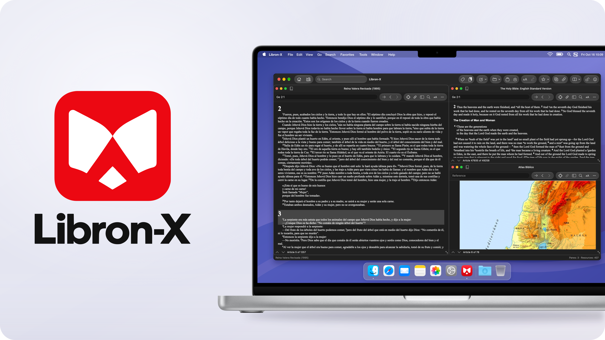

<h1 align="center">Libron-X</h1>

A native Bible study library for Mac, compatible with supported Libronix, classic Logos, e-Sword and EPUB resources.

  
  
  
  

  

## Download

**v0.5 prerelease · macOS 14+ · Apple Silicon.** Move the app to Applications and follow the [installation guide](docs/getting-started.md).

## Features

- Read Bibles, commentaries, books, maps and interlinears in linked panes.
- Follow any Bible in an independent commentary pane, with whole-chapter notes and illustrations.
- Search the library with persistent indexes, scopes, fields and advanced queries.
- Organize `.libron` resources with collections, priorities and associations.
- Generate bibliographies, copy citations and review duplicate editions.
- Look up words in twelve offline dictionaries.
- Keep notes, highlights, favorites and saved workspaces.
- Copy, print and export supported content; use ten interface languages.

Compatibility varies by resource. The optional [public-domain commentary pack](https://github.com/EstebanPdNS/Libron-X/releases/download/v0.5/Libron-X-v0.5-Commentaries.zip) adds five English classics. Original Libronix binaries and commercial books are not included.

[Documentation](docs/README.md) · [Build and test](docs/development.md) · [Changelog](CHANGELOG.md) · [Road to v0.9](docs/release-plan.md) · [Contribute](CONTRIBUTING.md)

## Bug reports

[Open an issue](https://github.com/EstebanPdNS/Libron-X/issues/new?template=bug_report.md) with the app/macOS versions, reproduction steps and available logs or screenshots. Remove private content; do not attach books or license files.

---

[MIT license](LICENSE) · [Third-party notices](BibliotecaLibre/THIRD_PARTY_NOTICES.md) · [Image credits](docs/images/README.md)

Libron-X is an independent project. Libronix and Logos belong to their respective owners.
