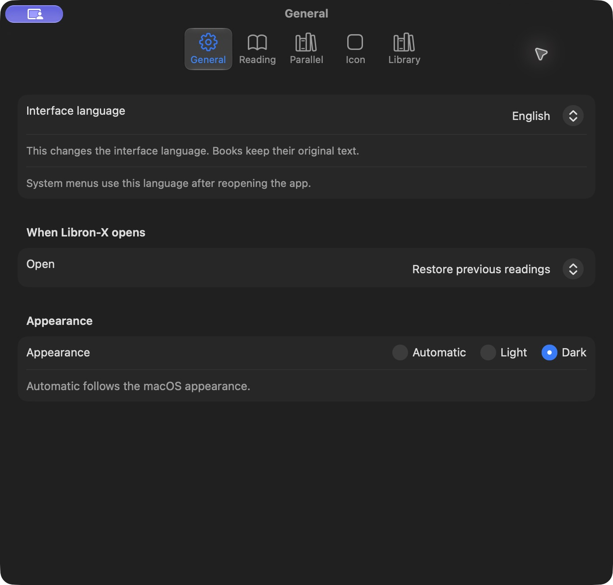

# Getting started

## Install v0.3

The supplied app is built for Apple Silicon. Its deployment target is macOS 14; the release was checked on the development Mac, not every supported macOS version. Intel binaries are not included.

1. Download `Libron-X-v0.3.zip` from the [v0.3 release](https://github.com/EstebanPdNS/Libron-X/releases/tag/v0.3).
2. Extract the ZIP and move `Libron-X.app` to Applications.
3. Open it. The app is ad-hoc signed, without Developer ID signing or notarization. If macOS blocks it, review the source and Apple's [instructions for opening apps](https://support.apple.com/en-us/102445), or build it yourself. Do not disable system protections.

The checksum file in the release identifies the uploaded ZIP. Compare it with `shasum -a 256 Libron-X-v0.3.zip`.

## Open a library

Use File → Open Resource Folder and select a local folder containing your own Libronix resources. Open My Library to filter and select books. Import reads source resources; personal changes are saved separately.

Use a reader's reference field for a Bible passage. Open more books and use the window arrangement menu to place them side by side. Linking and passage mapping require compatible Bible resources; unsupported destinations can fail explicitly.

Twelve attributed offline dictionaries are included: three each in Spanish, English, Portuguese and Italian. Some are synonym datasets. No commercial books, resource licenses, original program files or activation services are included. Recognizing a file in the library does not guarantee full reading support.

## Use English

Open Libron-X → Settings → General → Interface language and select English. App controls update immediately; restart for standard macOS menus and panels. The default interface language is Spanish. Books keep their original language.

## Keep personal data

Save a named workspace with File → Save Workspace. Normal exit also records the last workspace. This is not crash recovery. Back up `~/Library/Application Support/org.libronx.mac.rebuild/` before testing updates. It contains notes, favorites, workspace recovery and other personal settings; exported workspace files can also contain local paths.

If a resource fails, keep the original file unchanged and report the format, steps and visible message. Do not attach books, license files or personal notes to a public issue.
